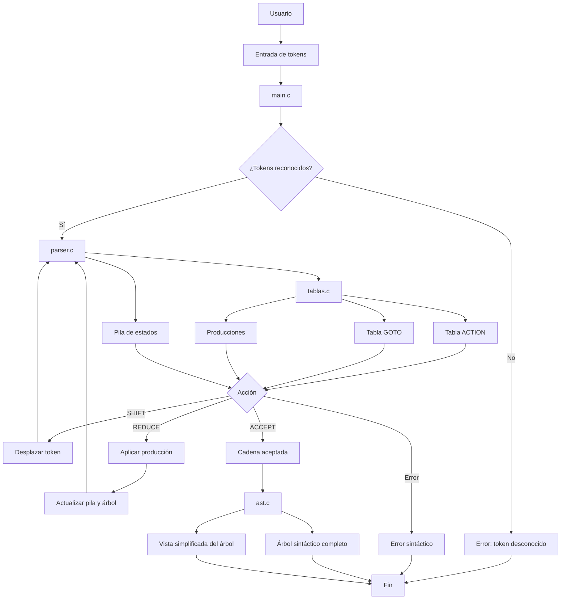

# Diagrama de arquitectura del analizador SLR(1)

El siguiente diagrama representa la organización y el
funcionamiento general del analizador sintáctico.

## Descripción

El programa comienza cuando el usuario introduce una
secuencia de tokens.

El archivo main.c identifica los tokens y los envía
al analizador implementado en parser.c.

El analizador utiliza una pila de estados y consulta
las tablas ACTION y GOTO definidas en tablas.c.

Dependiendo de la acción encontrada, realiza un
desplazamiento, una reducción, acepta la cadena
o informa de un error sintáctico.

Durante las reducciones se construye el árbol sintáctico.

Cuando la cadena es aceptada, el módulo ast.c permite
mostrar tanto el árbol completo como una representación
simplificada de su estructura.
